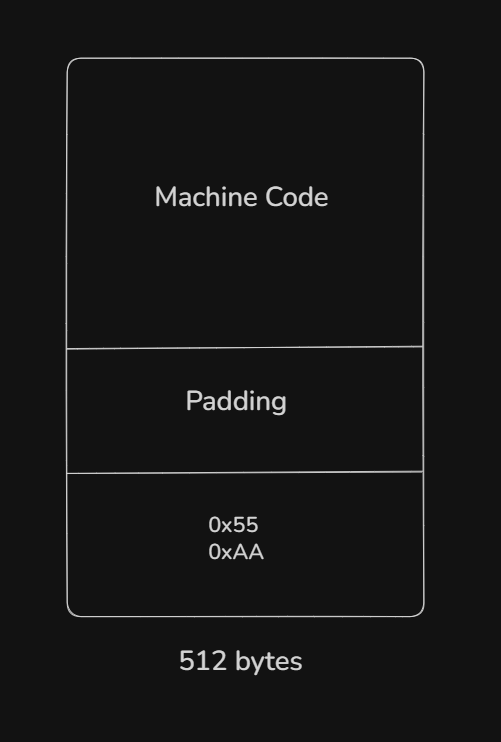

# Boot Sector Generator

C program that generates a **512-byte x86 boot sector** from scratch.

The program manually constructs x86 machine-code instructions, places them into a byte buffer, adds the required boot signature, and writes the result to a `.img` file.

## Build

```bash
gcc src/main.c -o bin/main.exe
gcc src/run.c -o bin/run.exe
```

## Run

```bash
bin/main.exe
bin/run.exe
```

## Boot Sector Layout


